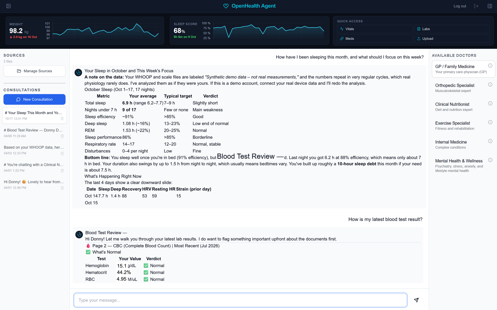

# OpenHealth Agent

**An agent-assisted Whoop-connected daily health companion, built on OpenHealth.**

Self-host your own health hub: connect your wearable and scale, keep the data on your own
server, and talk to it through an AI assistant that knows your numbers. No cloud account
required.

> Community-maintained, not affiliated with OpenHealthForAll — see Credits.

## What's new

- **2026-10-20 — Deploy with your AI**: copy [`docs/DEPLOY-PROMPT.md`](docs/DEPLOY-PROMPT.md) into any AI assistant with shell access to your server — it runs the full setup end to end and asks you the right questions along the way.
- **2026-10-20 — [`v0.3.0` released](https://github.com/openhealth-agent/openhealth-agent/releases/tag/v0.3.0)**: first versioned release, with a prebuilt container image — `docker pull ghcr.io/openhealth-agent/openhealth-agent:v0.3.0`.
- **2026-10-19 — Chat image attachments**: paste or pick images in a consultation
  (downscaled to 2000 px / JPEG in-browser), multiline composer (Shift+Enter for
  newlines), and a faster message stream. Full entry: [CHANGES.md](CHANGES.md#chat).
- Full history lives in [CHANGES.md](CHANGES.md).

## Screenshots



*All numbers shown are synthetic (see [`demo/`](demo/README.md)) — no real measurements appear in this repo.*

## What it does

- **WHOOP sync** — recovery, sleep, strain and workouts, merged into permanent history.
  Each install uses its own WHOOP developer app: [docs/WHOOP-SETUP.md](docs/WHOOP-SETUP.md).
- **Withings sync** — weight, body composition and blood pressure. Readings are **merged,
  never overwritten**: [docs/WITHINGS-SETUP.md](docs/WITHINGS-SETUP.md).
- **Manual readings** — blood pressure / weight entries by hand, CSV or API
  (`POST /api/readings`) into a record no sync ever touches.
- **Dashboard** — weight trend (sparkline with real axes and delta) and sleep history.
- **Document parsing** — upload blood-test PDFs/images; a vision model extracts structured
  results (no Docling/OCR stack to babysit).
- **Assistant modes** — GP, orthopaedics, nutrition, exercise, internal medicine, mental
  health: prepared context for the chat.
- **Chat attachments** — paste or pick images into a consultation; downscaled in-browser
  (2000 px / JPEG) and sent to vision-capable models as image content. Only the last 4
  image-bearing turns are re-sent with each message, to bound token cost.
- **Bring your own LLM** — configure the provider/model per consultation room.

## Why this version

Upstream [OpenHealthForAll/open-health](https://github.com/OpenHealthForAll/open-health)
has been effectively unmaintained since early 2026 (last release v0.2.0, Feb 2025). This is
a community fork that keeps it working and usable day to day:

| | Upstream | This project |
|---|---|---|
| Document parsing | Docling (fails on small VPSes) | Direct image-model parsing with retries |
| Wearable/scale sync | — | WHOOP + Withings service, permanent merge |
| Manual readings | — | `MANUAL_READINGS` + `/api/readings` |
| Dashboard | basic | weight/sleep sparklines with axes + tooltips |
| Model support | Claude 3.5/3.7 only | current models (default `claude-opus-5-5`, configurable via `DEFAULT_CHAT_MODEL`) |
| Deployment | manual | one-command Docker Compose, self-hosting guide, prebuilt image |
| Secrets | literals in code | environment-only, no fallbacks |
| Sync/OAuth endpoints | unauthenticated | key-gated; OAuth state-protected |

## Quick start

```bash
git clone https://github.com/openhealth-agent/openhealth-agent.git
cd openhealth-agent
cp .env.example .env       # fill it in: openssl rand -hex 32 for the secrets
docker compose up -d --build
```

Prebuilt image for self-hosters who'd rather pull than build:
`docker pull ghcr.io/openhealth-agent/openhealth-agent:v0.3.0` (`:latest` tracks the newest
release).

Put it behind a reverse proxy with TLS (nginx example in the self-hosting guide), open the
site, create your account, and optionally seed the demo data to see the dashboard
immediately.

Handing this to an AI assistant? Copy [`docs/DEPLOY-PROMPT.md`](docs/DEPLOY-PROMPT.md)
into it — the prompt runs the full setup on your server and asks you the right
questions along the way.

- Full guide: **[docs/SELF-HOSTING.md](docs/SELF-HOSTING.md)**
- Device setup: **[WHOOP](docs/WHOOP-SETUP.md)** · **[Withings](docs/WITHINGS-SETUP.md)**
- Demo data: **[demo/README.md](demo/README.md)**

## Requirements

- Docker + Docker Compose
- A domain with HTTPS (OAuth callbacks need a stable public URL)
- Optional: a WHOOP and/or Withings account. Other scales can be fed via CSV/API —
  pluggable providers are on the roadmap.

## Security notes

- All secrets live in `.env`; the code contains no credentials, and CI scans every push
  for secrets, personal identifiers and server paths.
- The sync service's `/connect`, `/status` and `/sync` endpoints require an
  `X-Sync-Key` header (browsers go through the app's authenticated relay at
  `/api/integrations/*`); OAuth callbacks remain public but are state-protected.
- Uploads require a logged-in session.
- Chat images are uploaded here and forwarded to your configured model provider as image
  content — the same data flow as any text you type in chat. Vision support is verified
  with Anthropic models (OpenAI expected to work; Google/Ollama untested).
- App and database bind to `127.0.0.1` by default — expose only through your reverse proxy.

## Roadmap

- CSV import for other scales/exporters; pluggable weight providers
- Blood-pressure card on the dashboard
- Real internationalization (the upstream language packs cover the original UI; new
  components are English-only — Thai is planned)

## Contributing

Open an issue before large PRs so we can agree on scope. Keep commits focused, run
`npm run build` before pushing (CI does too), and never commit real health data,
credentials or personal identifiers — the CI secrets gate rejects them. See
[CONTRIBUTING.md](CONTRIBUTING.md).

## Credits & license

- Based on [OpenHealth](https://github.com/OpenHealthForAll/open-health) by
  OpenHealthForAll — AGPL-3.0, upstream copyright retained. Changes from upstream are
  listed in [CHANGES.md](CHANGES.md) and [NOTICE.md](NOTICE.md).
- Community-maintained. **Not affiliated with or endorsed by OpenHealthForAll.**
- License: **AGPL-3.0**.

## Disclaimer

This is a personal health data tool — **not a medical device and not medical advice**. It
stores and presents data you provide; decisions about your health are yours and your
clinician's.
